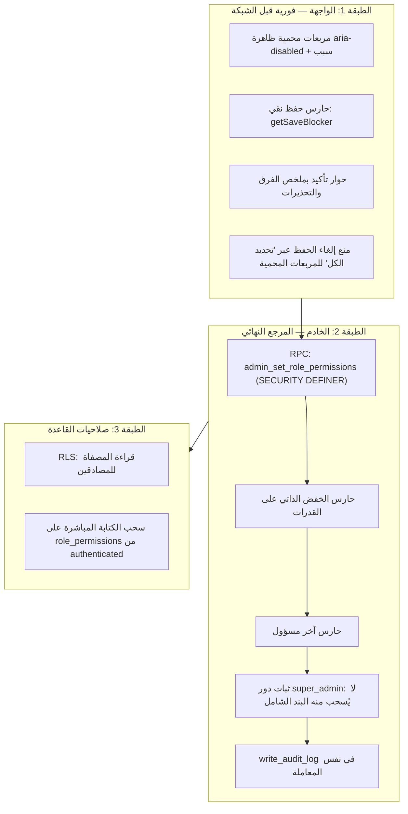

# دراسة استشارية معمارية وأمنية — شاشة الأدوار والصلاحيات (Roles & Permissions)

> **الحالة:** وثيقة تصميم تاريخية من مرحلة ما قبل التنفيذ؛ المقترحات والعقود الواردة أدناه **تصريحية (type-only)** وليست وصفاً كاملاً للسلوك الحالي.
> **تنبيه التحديث (2026-10-16):** أصبح `owner` دور التأسيس المحمي الذي يحصل عليه أول تسجيل Auth مع كل صفوف `public.permissions` صراحةً. يظل `super_admin` دوراً محمياً كما كان، ويحتفظ بمنح `*` التاريخي؛ أما التسجيلات اللاحقة فتحصل على `viewer`. للتشغيل الحالي وفروق الأدوار راجع `README.md` و`docs/runbooks/initial-setup.md`، ولتنفيذ قاعدة البيانات راجع migrations الحالية.
> **البيئة:** Vite 8 + React 19 + TypeScript 6 (strict) + Tailwind CSS 4 + TanStack Query v5 + Supabase (PostgreSQL / RLS).
> **القرار المعماري المؤسَّس:** لا Realtime في هذه الشاشة (ندرة العمليات الإدارية) — جلب عادي محمي عبر TanStack Query.

---

## 0. الخلاصة التنفيذية (TL;DR)

| المحور           | القرار المقترح في جملة                                                                                                                                                                                     |
| ---------------- | ---------------------------------------------------------------------------------------------------------------------------------------------------------------------------------------------------------- |
| الذرية           | **RPC واحدة** (`admin_set_role_permissions`) بـ SECURITY DEFINER تطبّق الفرق كله داخل معاملة PostgreSQL واحدة — لا حذف/إدراج من العميل أبداً.                                                              |
| الحذف ثم الإدراج | **مرفوض كسلسلة طلبات من العميل**، ومقبول فقط كتفصيل داخلي داخل الدالة الذرية، والأفضل منه **حساب الفرق (Diff) وإدخال/حذف المضاف والمنسحب فقط**.                                                            |
| الواجهة البرمجية | شجرة من **مستويين**: `module ← permissions` (العمود `module` موجود أصلاً في المخطط)، مع **Draft** يشتق `granted`/`revoked` كمجموعات قراءة فقط.                                                             |
| التصميم          | قسمان على الحاسب (قائمة الأدوار + شبكة الصلاحيات) يتحوّلان عبر **Container Queries** إلى تكديس رأسي متناسق على الموبايل.                                                                                   |
| A11y             | `fieldset/legend` لكل مجموعة + مربع "تحديد الكل" بحالة **indeterminate** الأصلية + `aria-describedby` للأسباب + `aria-live` للتغييرات المجمعة.                                                             |
| الحارس الذاتي    | **قاعدة ذهبية قائمية على القدرة (Capability-Based)** لا على العضوية: يُمنع أي تعديل يُفقد المحررَ الحالي قدرة `*` أو `roles.manage` عبر **كل** أدواره — مع إعادة تحقق إلزامية على الخادم داخل نفس الـ RPC. |

---

## 1. المحور الأول: هندسة البيانات والعمليات المجمعة (Bulk Operations & Atomicity)

### 1.1 لماذا تفشل "حذف ثم إدراج" من جهة العميل؟

- استدعاء `supabase.from('role_permissions').delete()...` ثم `.insert([...])` هو **طلبان HTTP = معاملتان منفصلتان**. أي فشل بينهما (انقطاع شبكة، قيد تحقق، انتهاء مهلة، صلاحيات) يترك الحالة **جزئية**: صلاحيات مسحوبة دون أن تُستبدل، أو مصفاة ناقصة.
- حتى `upsert` المجمّع لا يحلّ المشكلة لأنه يغطي **جدولاً واحداً فقط**، ولا يشمل الحذف، ولا يضمن اتساقاً مع التدقيق (audit) والقيود المشتركة.
- عميل `supabase-js` لا يوفّر معاملات متعددة الجمل (Multi-statement Transactions) على REST — وهذه قاعدة صلبة في PostgREST لا تُتجاوز إلا بتنفيذ المعاملة **داخل قاعدة البيانات نفسها**.

> **الحكم:** ❌ لا حذف/إدراج متسلسل من العميل تحت أي ظرف.

### 1.2 الخيارات الممكنة والقرار

| الخيار                                            | الذرية                             | التعقيد                   | الحكم                                                         |
| ------------------------------------------------- | ---------------------------------- | ------------------------- | ------------------------------------------------------------- |
| أ) طلبتان منفصلتان (delete ثم insert)             | ❌ لا                              | منخفض                     | **مرفوض** — نافذة فشل جزئي                                    |
| ب) استدعاء RPC واحدة تُجري كل شيء داخل جسم الدالة | ✅ نعم (جسم الدالة = معاملة واحدة) | متوسط                     | **✅ المعتمد** — وهو نفس النمط الحالي `admin_set_user_status` |
| ج) Edge Function بمفتاح `service_role`            | ✅ نعم                             | مرتفع (بنية تحتية إضافية) | غير مبرَّر لندرة العمليات                                     |
| د) `db.transaction` في العميل                     | ❌ غير متوفر في supabase-js REST   | —                         | غير موجود أصلاً                                               |

**القرار:** دالة قاعدة بيانات واحدة — `admin_set_role_permissions` — هي **المسار المعتمد والوحيد للكتابة**، تماماً كما فعلنا في `admin_set_user_status` (الشاشة الأولى)، وبنفس فلسفة التقوية: نسحب صلاحيات الكتابة المباشرة على `role_permissions` من `authenticated` بحيث لا يكون هناك بديل للدالة.

### 1.3 داخل الدالة الذرية: Diff وليس Delete-All + Insert

- نُرسل من الواجهة **الحالة النهائية المرغوبة كاملة** (Desired Set) لمعرفات الصلاحيات — لا "العمليات".
  - الحفظ يصبح **Idempotent**: إعادة المحاولة بعد فشل شبكة لا تكرّر أثراً.
  - الخادم يحسب الفرق بنفسه: `grant = المطلوب − الموجود`، `revoke = الموجود − المطلوب`.
- التفصيل الداخلي المفضّل:
  1. التحقق (انظر 1.6) — أي فشل يُبطل **كل شيء**.
  2. `INSERT` للصفوف المضافة فقط (مع `on conflict do nothing` لمناعة إضافية على المفتاح المركب `(role_id, permission_id)`).
  3. `DELETE` للصفوف المنسحبة فقط.
  4. سطر تدقيق **في نفس المعاملة** عبر `write_audit_log`.
  5. إرجاع الحالة النهائية + `updated_at` للدور.
- "حذف الكل ثم إدراج الكل" **داخل** الدالة سيظل ذرياً (لا خطر فشل جزئي)، لكنه:
  - يُتلف `granted_at` ويصفّر تاريخ المنح،
  - كتابة/قفل مبالغ فيهما على الجدول،
  - غير Idempotent في الروح (يبدو كسحق كامل حتى لو لم يتغير شيء).
  - **لذلك: Diff هو المعتمد، وDelete-All+Insert داخل الدالة مقبول فقط كخطة تبسيط عند مراجعة الفريق.**

### 1.4 كيف نحمي من الفشل الجزئي؟ (قائمة تحقق)

1. **ذرة المعاملة على الخادم:** أي `raise exception` داخل الدالة = rollback كامل تلقائياً (لا يمكن أن تُكتب نصف الصلاحيات).
2. **التحقق قبل الكتابة (Validate-then-Write):** وجود الدور، وجود كل معرف صلاحية، عدم التكرار، وصحة الفرق — قبل أول `insert`.
3. **لا حالة متفائلة مخادعة في الواجهة:** بعد النجاح نستبدل الكاش من **استجابة الـ RPC الرسمية** أو نُبطل الكاش (`invalidateQueries`) ونجذب من الخادم — لا نخمّن النتيجة محلياً. (نفس نمط `useUsersManagement`).
4. **اتحاد النتائج المميّزي (Discriminated Union):** النتيجة إما نجاح بالمُخرَجات أو فشل بكندية خطأ — لا استثناءات عارية تصل الواجهة.
5. **التدقيق داخل المعاملة نفسها:** سطر `audit_logs` يُكتب فقط إذا نجحت المعاملة؛ فلا يوجد سجل تدقيق يدّعي عملية لم تحدث (وهذا أفضل من التدقيق من جهة العميل).
6. **التعارض المتزامن (اختياري لكن موصى به):** توكن تفاؤل `expectedUpdatedAt` مأخوذ من `roles.updated_at`؛ إن تغيّر الدور منذ فتح الشاشة يرفض الخادم بكندية `version-conflict` بدلاً من الكتابة فوق تعديل زميل — وندرة العمليات لا تلغي احتمال تزامن مسؤولَين.

### 1.5 عقد الدالة الذرية (Declarative Contract — بلا كود)

| البند                | الوصف                                                                                                                                          |
| -------------------- | ---------------------------------------------------------------------------------------------------------------------------------------------- |
| الاسم                | `admin_set_role_permissions`                                                                                                                   |
| النوع                | `SECURITY DEFINER`، `set search_path = public` (نمط التقوية الحالي)                                                                            |
| المدخلات             | `p_role_id uuid` · `p_permission_ids uuid[]` (الحالة النهائية) · `p_expected_updated_at timestamptz` (اختياري)                                 |
| المخرجات             | كائن/jsonb: `{ role_id, granted: uuid[], revoked: uuid[], updated_at }`                                                                        |
| الصلاحيات            | `revoke` من `public, anon` · `grant execute` لـ `authenticated, service_role` (كما في التقوية الحالية)                                         |
| أكواد الرفض المميّزة | `42501` غير مصرّح · `P0002` الدور غير موجود · `55000`/مخصص: `self-demotion` · `last-admin-lockout` · `system-role-locked` · `version-conflict` |
| التدقيق              | `write_audit_log` داخل نفس المعاملة (ينظر 1.8)                                                                                                 |

### 1.6 التحققات الإلزامية داخل الدالة (قبل أي كتابة)

1. `is_admin()` — المُستدعي مدير فعّال (نفس منطق `admin_set_user_status`).
2. الدور موجود؛ ووجود كل معرف في `p_permission_ids` ضمن `permissions` (رفض `P0002` بدل إسقاط صامت).
3. **حارس الخفض الذاتي** (المحور 3 كاملاً): هل يفقد المُستدعي قدرة `*` أو `roles.manage` بعد التطبيق؟ → رفض.
4. **حارس آخر مسؤول:** هل يترك التعديل النظامَ بلا أي مستخدم يملك القدرات الحرجية؟ → رفض.
5. **ثبات أدوار النظام:** منع نزع `*` من دور `super_admin` مهما كان المحرر (ثابت نظام لا يقبل التفاوض).
6. سحب صلاحيات الكتابة المباشرة على `role_permissions` من `authenticated` (دفاع في العمق — كما سحبنا `UPDATE` على `profiles.status`) بحيث **لا توجد مسطرة كتابة بديلة** تتجاوز الدالة.

### 1.7 الواجهات البرمجية (TypeScript Interfaces — عقود تصريحية فقط)

> المبدأ: **نماذج المجال (Domain) للقراءة + Draft قابل للاشتقاق + اتحاد نتائج مميّزي** — نفس روح `ManagedUser` و`SetUserStatusResult` في الشاشة الأولى، مع `readonly` في كل مكان ومنع الـ `null` الزائف.

```ts
/* ===== عقود نوعية (type-only) — لا منطق تنفيذي ===== */

/** شريحة الشجرة: صف من public.permissions. */
export interface Permission {
  readonly id: string;
  readonly slug: string; // '*' | 'roles.manage' | 'users.manage' | ...
  readonly module: string; // مفتاح المجموعة المنطقية (يقابل عمود permissions.module)
  readonly nameAr: string;
  readonly nameEn: string;
  readonly description: string | null;
}

/** المجموعة المنطقية: module ← صلاحياته (الشجرة هنا بمستويين). */
export interface PermissionGroup {
  readonly module: string;
  readonly nameAr: string;
  readonly nameEn: string;
  readonly permissions: readonly Permission[];
}

/** صف من public.roles مع أثر التغيير (عدد المتأثرين). */
export interface RoleSummary {
  readonly id: string;
  readonly slug: string; // 'super_admin' | 'admin' | 'editor' | 'viewer' | ...
  readonly nameAr: string;
  readonly nameEn: string;
  readonly isSystem: boolean; // roles.is_system — عزل أدوار النظام
  readonly assignedUserCount: number; // للتحذير من اتساع التأثير
}

/** الحالة المرجعية المحفوظة فعلاً في role_permissions. */
export interface RolePermissionBaseline {
  readonly roleId: string;
  readonly permissionIds: ReadonlySet<string>;
}

/** حالة التحرير المؤقتة — الفرق **مشتق** لا مخزَّن (مصدر واحد للحقيقة). */
export interface RolePermissionDraft {
  readonly roleId: string;
  readonly baseline: ReadonlySet<string>;
  readonly selected: ReadonlySet<string>;
  readonly granted: ReadonlySet<string>; // = selected − baseline
  readonly revoked: ReadonlySet<string>; // = baseline − selected
  readonly isDirty: boolean;
}

/** حالة مربع "تحديد الكل" للمجموعة — تغذّي indeterminate. */
export type GroupToggleState = 'none' | 'some' | 'all';

/** مدخلات الحفظ: الحالة النهائية الكاملة (Idempotent). */
export interface ApplyRolePermissionsInput {
  readonly roleId: string;
  readonly permissionIds: readonly string[];
  readonly expectedUpdatedAt?: string; // حارس التفاؤل (اختياري)
}

/** نتيجة الحفظ — اتحاد تمييزي؛ لا شيء يُرمى (throw) للواجهة. */
export type ApplyRolePermissionsResult =
  | {
      readonly ok: true;
      readonly roleId: string;
      readonly granted: readonly string[];
      readonly revoked: readonly string[];
      readonly updatedAt: string;
    }
  | { readonly ok: false; readonly roleId: string; readonly code: RolePermissionErrorCode };

/** أكواد الأخطاء المعيارية (تُترجم عبر القاموس ثنائي اللغة). */
export type RolePermissionErrorCode =
  | 'unavailable'
  | 'forbidden'
  | 'not-found'
  | 'noop'
  | 'in-flight'
  | 'self-demotion'
  | 'last-admin-lockout'
  | 'system-role-locked'
  | 'version-conflict'
  | 'rate-limited'
  | 'network'
  | 'unknown';

/** حارس الحفظ — دالة **نقية** تُفحص قبل أي طلب شبكة. */
export interface SaveBlockerContext {
  readonly draft: RolePermissionDraft;
  readonly actor: {
    readonly id: string;
    readonly roleIds: readonly string[]; // كل أدوار المحرر (user_roles)
    readonly capabilities: ReadonlySet<string>; // القدرات الفعلية عبر كل أدواره
  };
  readonly criticalSlugs: readonly string[]; // ['*', 'roles.manage']
  readonly activeCapabilityHolders: number; // لحارس "آخر مسؤول"
}

export type SaveBlocker = Extract<
  RolePermissionErrorCode,
  'self-demotion' | 'last-admin-lockout' | 'system-role-locked' | 'noop' | 'forbidden' | 'not-found'
>;
```

**ملاحظات التصميم على العقود:**

- **الشجرة = مستويان فقط** (`module ← permissions`)، وهي كافية تماماً لأن العمود `module` موجود في المخطط ويغطي مجموعات seed الحالية: `dashboard` · `workspace` · `system` · `app`. لا حاجة لجدول فئات منفصل إلا إذا تطلّب المنتج مستويات أعمق لاحقاً — وعندها نضيف `parent_id` بترحيل صغير دون كسر العقود.
- `granted`/`revoked` **مشتقة** عبر getters/dirty-derivation في الـ hook (احتساب عند التغيير) — لا تُخزَّن بالتوازي مع `selected` حتى لا تتناقض أبداً.
- `ReadonlySet<string>` يمنع التعديل الانتهازي من مكوّنات الواجهة (نفس أسلوب `readonly` في `ManagedUser`).
- `GroupToggleState` مشتق من الحالة: `none` (لا شيء) · `some` (جزئي → indeterminate) · `all` (الكل) — وانظر تفصيل المربعات المحمية في المحور 2/3.

### 1.8 التدقيق (Audit)

- القيم الحالية في `audit_action`: `role.granted` / `role.revoked` (تُخصّصان لتغيّر أدوار المستخدمين في `user_roles`).
- **الاقتراح:** إضافة قيمة جديدة `role.permissions_updated` للنوع `enum` (ترحيل `alter type ... add value`)، مع metadata داخل سطر التدقيق نفسه:
  - `role_slug`، `granted: [slugs]`، `revoked: [slugs]`، `actor_capabilities_before`.
- البديل الأرخص: إعادة استخدام `role.granted`/`role.revoked` مع metadata — لكنه يشوش تقارير "منح/سحب الأدوار عن المستخدمين". **نوصي بالقيمة الجديدة.**

### 1.9 استراتيجية الجلب (Read Path — بلا Realtime)

- **مفتاح كاش واحد** `['roles-permissions']` هو مصدر الحقيقة الوحيد للشاشة (نمط `USERS_QUERY_KEY`).
- جولتا شبكة كحد أقصى، بلا N+1:
  1. `roles` مع embed: `role_permissions(permission_id)` (+ عدد المستخدمين عبر عدّاد أو embed `user_roles`).
  2. `permissions` (جدول صغير عام) — تُرتّب وتُجمَّع في الواجهة حسب `module`.
- `staleTime` معتدل (العمليات نادرة: ٦٠ ثانية مثالية) + `invalidateQueries` بعد كل حفظ + إعادة الجلب عند تركيز النافذة (سلوك React Query الافتراضي كافٍ).
- قراءة المصفاة محمية بـ RLS الحالي (`authenticated`) — يبقى `RequireAuth` حارس المسار.

---

## 2. المحور الثاني: واجهة المستخدم وتجربة التصفح المتجاوبة (UI/UX & A11y)

### 2.1 تقسيم الشاشة (Conceptual Layout)

```text
┌──────────────────────────── الحاسب (Container ≥ 4xl) ────────────────────────────┐
│  [شريط الإجراءات: ملخص التعديلات · حفظ · تراجع]  (sticky)                        │
├──────────────────┬──────────────────────────────────────────────────────────────┤
│ قائمة الأدوار    │  شبكة الصلاحيات — مجمّعة حسب module                          │
│ (عمود ثابت)      │                                                              │
│ ┌──────────────┐ │  ▸ مجموعة النظام ................................ [تحديد الكل]│
│ │ super_admin  │ │     ☑ *  (كل الصلاحيات)                ⚠ محمي                │
│ │ admin        │ │     ☑ roles.manage                     ⚠ محمي                │
│ │ editor       │ │     ☐ users.manage                                              │
│ │ viewer       │ │     ☐ backup.manage                                             │
│ └──────────────┘ │  ▸ مجموعة التطبيق ....................... [تحديد الكل]        │
│ بحث + شارات      │     ☐ settings.manage · ☐ appearance.manage · ...              │
│ (is_system)      │  ▸ مجموعة مساحات العمل ................... [تحديد الكل]        │
│                  │     ☑ workspace.1.access · ☐ 2 · ☐ 3                           │
└──────────────────┴──────────────────────────────────────────────────────────────┘

┌──────────────────── الموبايل (Container < 4xl) ────────────────────┐
│ [شريط الإجراءات ملتصق بالأسفل + safe-area]                         │
│ قائمة الأدوار (رأسية، مدمجة، مع بحث)                              │
│ ── ثم شبكة الصلاحيات مكدّسة: كل مجموعة fieldset بعرض كامل ──       │
│ (لا أعمدة — نفس المكوّنات، تغيّر التخطيط فقط عبر Container Queries)│
└────────────────────────────────────────────────────────────────────┘
```

### 2.2 قواعد الكسر عبر Container Queries (لا Media Queries)

- سبب الاختيار: الشاشة تعيش **داخل** تخطيط Dashboard (شريط جانبي قابل للضم + درج موبايل)؛ عرض النافذة ≠ عرض الحاوية. `@container` تتكفّل بالتكيف حتى مع ضمّ الشريط الجانبي — وهو نمط معمول به فعلاً في `UsersManagement` (`@2xl:` لتحويل الجدول إلى بطاقات).
- المستوى التقني (تصريحي):
  - حاوية الشاشة تحمل `@container` وتسمية `@screen roles-panel`.
  - تحت نقطة الكسر: `grid-cols-1` (تكديس: الأدوار ثم الشبكة).
  - فوق نقطة الكسر (`@4xl` مثلاً — تُحسم بالتجربة): `grid-cols-[16rem_1fr]` مع خصائص CSS المنطقية (`start/end`) حتى ينعكس التخطيط تلقائياً في RTL.
- سلوك الموبايل المفضّل (للنقاش):
  - **الأولى:** قائمة أدورار رأسية مدمجة أعلى الشاشة (أبسط وأكثر وصولاً) + مجموعات مكدّسة.
  - **البديل:** شريط أدوار أفقي (chips) مع scroll-snap — أجمل بصرياً لكنه أثقل على قارئات الشاشة وعلى التنقل بلوحة المفاتيح؛ نعتمد الأول ما لم يقرر الفريق غير ذلك.
  - زر الحفظ على الموبايل: شريط سفلي ملتصق (مع `env(safe-area-inset-bottom)`)، وعلى الحاسب: شريط علوي sticky.
- **التنقل بين الأدوار مع تعديلات غير محفوظة:** حوار تأكيد + مانع مسار (`useBlocker` من react-router) — الغيارات المؤقتة لا تُهمل بصمت.

### 2.3 حالات الشاشة (State Matrix)

| الحالة             | المظهر                                                  |
| ------------------ | ------------------------------------------------------- |
| تحميل              | هيكل عظمي (Skeleton) لكل عمود + `aria-busy`             |
| فشل الجلب          | `role="alert"` + إعادة المحاولة (نمط `UsersManagement`) |
| لا أدوار           | `EmptyState` جاهز                                       |
| دور بلا صلاحيات    | رسالة داخل الشبكة + "تحديد الكل" كمسار للبدء            |
| تعديلات غير محفوظة | شارة "تعديلات غير محفوظة (n)" + إبراز الفروق بصرياً     |
| حفظ جارٍ           | `aria-busy` + تعطيل الأزرار بـ `aria-disabled`          |
| حارس مانع          | سبب موصول بـ `aria-describedby` (انظر المحور 3)         |

### 2.4 مربّعات الاختيار وتوافق قارئات الشاشة (A11y)

1. **البنية:** كل مجموعة صلاحيات = `<fieldset>` + `<legend>` يحمل اسم المجموعة **و** الملخص الحيّ ("٣ من ٥ مفعّلة"). هذا هو العنصر الوحيد الذي يعرّف مجموعة المربعات صوتياً بشكل موثوق.
2. **"تحديد الكل" (المربّع الرئيسي):**
   - مربع أصلي `<input type="checkbox">` (لا `div` بـ `role="checkbox"` — نفقد السلوك الأصلي).
   - الحالة الثالثة **indeterminate** تضبط عبر **خاصية DOM** (`input.indeterminate = true`) لا عبر سمة؛ قارئات الشاشة الأصلية تعلن حينها "محدّد جزئياً" تلقائياً، والحدة (`:indeterminate`) مسؤولة عن المظهر.
   - التسمية: "تحديد كل صلاحيات {المجموعة}" — وعند التفعيل يشمل **غير المحمي فقط**؛ الملخص الحيّ يوضح: "تم تحديد ٤، مع استثناء ١ محمية".
3. **التسميات الفرعية:** كل مربع موصول بتسميته عبر `id`/`for` (أو `<label>` يحتوي المربع)، والوصف التوضيحي (`description`) موصول عبر `aria-describedby`.
4. **المربعات المحمية (المحور 3):** تبقى **ظاهرة** لكن `aria-disabled="true"` + سبب عبر `aria-describedby` ("محمي: سحب هذه الصلاحية يقطع وصولك الحالي") — بدلاً من `disabled` الذي يُخرجها من ترتيب التنقل ويُخفي السبب. النقر عليها يُظهر السبب ولا يغيّر الحالة (نمط `aria-disabled` المعمول به في `UsersManagement`).
5. **الإعلانات المجمّعة:** منطقة `aria-live="polite"` مخفية بصرياً تعلن "تم تحديد/إلغاء ٥ صلاحيات في مجموعة النظام" عند "تحديد الكل" — والإعلان عن الفروق عند الحفظ عبر `role="status"`، والأخطاء عبر `role="alert"`.
6. **ترتيب التركيز:** المربّع الرئيسي أولاً ثم الأولاد؛ المسافة (Space) تبدّل؛ لا مفاتيح مخصصة تكسر العرف. زر الحفظ في نهاية التسلسل الطبيعي أو في شريط sticky بترتيب منطقي.
7. **RTL:** خصائص منطقية (`ps-`/`pe-`) في كل القياسات؛ الأيقونات الاتجاهية (chevrons) تُعكس بمنطق `rtl:` — والمحتوى النصي كما هو.
8. **الحوار التأكيدي قبل الحفظ:** نفس نمط حوار `UsersManagement` (portal + حصر التركيز + Escape + `aria-modal`)، لكن بمحتوى **ملخص الفرق**: "سيتم منح ٣ وسحب ٢ — بينها صلاحيات تؤثر على وصولك".

---

## 3. المحور الثالث: الأمن وحارس خفض الصلاحيات الذاتي (Self-Demotion Guard)

### 3.1 نموذج التهديد

- **الخطر الأساسي:** خطأ بشري (نقرة خاطئة، "تحديد الكل" ثم إلغاء، لصق قرار) يُفقد المديرَ الحالي قدرة إدارة الأدوار → لا يستطيع إصلاح نفسه → **قفل إداري كامل** (النظام يعمل لكن لا أحد يستطيع تغيير الصلاحيات).
- **ما لا نعالج هنا:** خبيثة مقصودة بوصول قاعدة البيانات مباشرة — ذلك يُحاسَب بسياسات قاعدة البيانات والنسخ الاحتياطي، لا بالواجهة.
- **الفارق عن حارس الشاشة الأولى:** هناك كان الحارس على **صف المستخدم** (لا تعطّل نفسك / لا تعطّل آخر مدير). هنا الحارس على **محتوى الدور** — وهو أدق: الدور قد لا يحمل اسمك، وقد تحمل أدواراً متعددة.

### 3.2 القاعدة الذهبية: حارس قائم على القدرة لا على العضوية

> **لا يُسمح بأي تعديل يجعل المحررَ الحالي يفقد — عبر _كل_ أدواره الممنوحة له — القدرةَ الحرجية `*` أو `roles.manage`.**

- التحقق **ليس** "هل أعدّل دوري؟" فقط — بل محاكاة نتائج `has_permission` بعد التطبيق:
  - المحرر يحمل `super_admin` (الذي يمنح `*`) و`editor` → نزع `roles.manage` من `editor` **مسموح** (لا يفقد شيئاً — `*` من `super_admin` يكفيه).
  - المحرر يحمل دور `admin` فقط (يمتلك `roles.manage` دون `*`) → نزع `roles.manage` من `admin` **محظور** حتى لو لم يكن "دوره المسمّى" — لأن قدرته تتبخر.
  - تعديل دور لا يملكه المحرر إطلاقاً → **مسموح** (لا أثر على قدرته)، ما لم يُخلّ النظامَ بآخر مسؤول (الحارس الثاني).
- القدرات الحرجة المرجعية في الـ seed الحالي:
  - `*` — كل الصلاحيات (وتُعامَل كواحدة حاسمة لا تُفكَّك).
  - `roles.manage` — (ما يقابل `roles:write` في صياغة التوجيه؛ انظر الملحق أ).
  - **للنقاش:** هل نضيف `users.manage` للقائمة؟ الأدلة: بدونها قد يفقد المدير إصلاحَ الحسابات — لكنه يستطيع تغيير الأدوار فيبقى القفل غير مطلق. **التوصية: لا نضيفها للمنع، لكن نضيفها للتحذير (Warning في الحوار).**

### 3.3 طبقات الدفاع (Defense in Depth) — المخطط المنطقي



### 3.4 مصفوفة السيناريوهات (قرارات مبرمجة مسبقاً)

| #   | السيناريو                                           | القرار                               | مصدر التنفيذ           |
| --- | --------------------------------------------------- | ------------------------------------ | ---------------------- |
| 1   | سحب `*` من أي دور يمنح المحررَ هذه القدرة حالياً    | ❌ مرفوض `self-demotion`             | واجهة + RPC            |
| 2   | سحب `roles.manage` من أي دور يمنح المحررَها حالياً  | ❌ مرفوض `self-demotion`             | واجهة + RPC            |
| 3   | سحب `*` من دور `super_admin` مهما كان المحرر        | ❌ مرفوض دائماً `system-role-locked` | RPC (ثابت نظام)        |
| 4   | تعديل يترك النظام بلا أي مستخدم يملك القدرات الحرجة | ❌ مرفوض `last-admin-lockout`        | RPC (وليس فقط الواجهة) |
| 5   | سحب صلاحية عادية من الدور الحالي للمحرر             | ✅ مسموح بعد تأكيد                   | واجهة                  |
| 6   | تعديل أدوار النظام `is_system` (غير `super_admin`)  | ⚠ قرار مفتوح (انظر 3.7)              | —                      |
| 7   | تعديل دور لا يملكه المحرر ولا يهدد آخر مسؤول        | ✅ مسموح                             | —                      |

### 3.5 التزامن بين الواجهة والخادم (قاعدة عدم الثقة)

- حارس الواجهة **للراحة والإرشاد فقط** (يعطي سبباً فورياً بالعربية/الإنجليزية قبل الضغط على الحفظ).
- حارس الـ RPC **هو المرجع الملزم** — يُعاد حساب القاعدة الذهبية هناك بنفس منطق `has_permission` (تطابق slug أو `*`)، لأن العميل يمكن تجاوزه.
- تطابق المصدرين يُختبر باختبارات وحدة على الدالة النقية + اختبار تكامل على أكواد رفض الـ RPC (انظر 5).

### 3.6 سيناريو "تحديد الكل" والحراس

- "تحديد الكل" **لا يلمس** المربعات المحمية أبداً (تبقى على حالتها)، ويُعلن الملخص: "تم تحديد ٤، مع استثناء ١ محمية".
- "إلغاء تحديد الكل" بالمثل: المربعات المحمية تبقى مفعّلة — فلا يمكن بلوغ حالة محظورة عبر الواجهة الجماعية أصلاً (المنع عند المصدر أدق من المنع عند الحفظ).
- الحارس عند الحفظ يبقى ضرورياً كخط ثانٍ (اختصار لوحة مفاتيح، سلوك مستقبلي، خلل في المنطق).

### 3.7 مصير أدوار النظام (`is_system`) — قرار مطلوب من الفريق

- **الخيار أ (الأكثر أماناً):** مصفوفة أدوار النظام للقراءة فقط؛ التغيير عبر ترحيل/خدمة فقط.
- **الخيار ب (المقترح للمرونة):** قابلة للتحرير **لكن** بحوار تأكيد صارم ("أنت تعدّل دوراً نظامياً يؤثر على N مستخدم") + ثابت `super_admin` غير قابل للنقاش (البند 3 في الجدول).
- **التوصية:** الخيار ب + الحارسان (`system-role-locked` لـ `*`، `last-admin-lockout` للقدرات).

### 3.8 العزل الإضافي (Privileges)

- سحب `INSERT/UPDATE/DELETE` على `role_permissions` من `authenticated` — تبقى القراءة، وتبقى الكتابة عبر الـ RPC وحدها. هذا يغلق "الطريق الخلفي" عبر PostgREST تماماً كما أُغلق `profiles.status`.
- نفس المعالجة لاحقاً لـ `roles` و`user_roles` إن لزم — لكن نطاق هذه الشاشة يقتصر على `role_permissions` (و`roles` عند إنشاء/تعديل الأدوار — قرار لاحق).

---

## 4. نقاط النقاش والاعتماد المطلوبة

1. **الذرية:** اعتماد RPC واحدة (`admin_set_role_permissions`) كمسار كتابة وحيد + سحب الكتابة المباشرة على `role_permissions`؟ (التوصية: نعم)
2. **تفصيل الحفظ:** Diff داخل الدالة (موصى) أم Delete-All+Insert للتبسيط؟
3. **القدرات الحرجة:** `['*', 'roles.manage']` للمنع، مع تحذير فقط على `users.manage`؟ (التوصية: كما ذُكر)
4. **أدوار النظام:** الخيار أ (قراءة فقط) أم ب (تحرير بتأكيد مشدد)؟ (التوصية: ب)
5. **حارس "آخر مسؤول":** اعتماده على مستوى الـ RPC؟ (التوصية: نعم — إلزامي)
6. **التفاؤل المتزامن:** تفعيل `expectedUpdatedAt` من الآن أم تأجيله؟ (التوصية: تفعيله — تكلفته زهيدة)
7. **التدقيق:** إضافة قيمة `role.permissions_updated` إلى `audit_action`؟ (التوصية: نعم)
8. **الموبايل:** قائمة أدورار رأسية (موصى) أم شريط أفقي chips؟
9. **نقطة الكسر:** `@4xl` للتقسيم الثنائي — تُحسم بتجربة على مقاسات Dashboard الفعلية.
10. **التسمية:** توحيد `roles:write` (التوجيه) على `roles.manage` (الـ seed) في القاموس والوثائق؟ (التوصية: `roles.manage`)

---

## 5. خارطة التنفيذ المقترحة (فقط — بعد الاعتماد)

1. **ترحيل SQL:** دالة `admin_set_role_permissions` (تحققات + حراس + diff + تدقيق) + revoke الكتابة المباشرة + قيمة `role.permissions_updated` + أكواد رفض معيارية.
2. **`npm run db:types`** — تجديد `src/types/database.types.ts`.
3. **طبقة البيانات:** `useRolesPermissions.ts` بهيئة `useUsersManagement` (كاش واحد، أكواد أخطاء معيارية، حراس نقية، `ApplyRolePermissionsResult`).
4. **الواجهة:** `RolesPermissions.tsx` + ربطها في `SettingsPage` (مكان `EmptyState` لقسم `roles`)، وحوار التأكيد بنمط الحوار الحالي.
5. **القاموس:** مفاتيح `roles.error.*` / `roles.block.*` في `ar.ts` و`en.ts`.
6. **الاختبارات:** وحدة للحراس النقية وحالات `GroupToggleState` · RTL للبنية الدلالية للمربعات و`indeterminate` · تكامل لرسم خرائط أكواد أخطاء الـ RPC · اختبار "لا يمكن بلوغ حالة محظورة عبر تحديد الكل".

---

## الملحق أ — مطابقة المصطلحات

| صياغة التوجيه | القيمة الفعلية في المخطط/الـ seed  | ملاحظة                                                       |
| ------------- | ---------------------------------- | ------------------------------------------------------------ |
| `roles:write` | `roles.manage`                     | نفس المفهوم؛ نوحّد على الصيغة الموجودة في `permissions.slug` |
| `*`           | `*`                                | wildcard تمنحه `has_permission` لأي صلاحية                   |
| "دور نفسه"    | دور يحمله المحرر عبر `user_roles`  | التحقق الفعلي **قدراتي** لا عضوي (القاعدة الذهبية)           |
| Super Admin   | `roles.slug = 'super_admin'` + `*` | يقابلهما `is_admin()` على الخادم                             |

## الملحق ب — أين يلتقي التصميم بالكود القائم

| النمط القائم (الشاشة الأولى)                     | امتداده في شاشة الأدوار                               |
| ------------------------------------------------ | ----------------------------------------------------- |
| `USERS_QUERY_KEY` كاش وحيد                       | `ROLES_PERMISSIONS_QUERY_KEY`                         |
| `getStatusChangeBlocker` (نقي، قبل الشبكة)       | `getSaveBlocker` (نفس الروح، على Draft)               |
| `admin_set_user_status` (RPC + رفض ذاتي)         | `admin_set_role_permissions` (RPC + رفض ذاتي وقدراتي) |
| أكواد `UserManagementErrorCode` → قاموس ثنائي    | `RolePermissionErrorCode` → `roles.error.*`           |
| `@2xl` Container Queries للجدول/البطاقات         | `@container` للتقسيم الثنائي/التكديس                  |
| حوار مؤكّد (portal + focus trap + Escape)        | حوار ملخص الفرق + تحذيرات الحراس                      |
| سحب صلاحيات الكتابة المباشرة (`profiles.status`) | سحب الكتابة المباشرة على `role_permissions`           |
